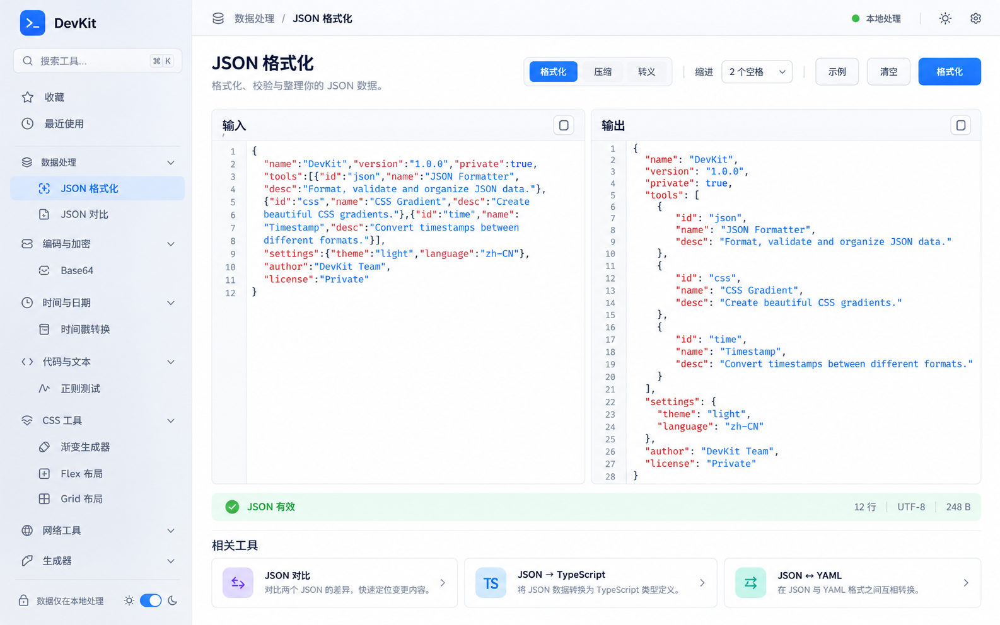

# 设计风格规范

## 1. 方向与参考

Apple 风格的网页生产力工具：清晰层级、克制色彩、精细边框、适量留白和轻量透明感。保留网页导航习惯，不加入 macOS 红黄绿窗口按钮、Dock 或设备外壳，不使用 Apple 标志。

参考图用于布局与气质。图中的示例数据、行数、字节数和重复操作不是规格；实现必须根据真实状态计算。选用当前文档规定的单一运行按钮，避免“格式化”模式与按钮视觉重复。

## 2. 页面布局

- 桌面 ≥ 1200px：左侧 240px 导航，顶部 56px 工具栏；内容内边距 24px，主区填满可用宽度。
- 768–1199px：侧栏可折叠至 64px 图标栏，点击展开完整导航；输入输出在各自 ≥ 320px 时双栏，否则堆叠。
- < 768px：顶栏菜单打开抽屉；主区 16px 边距；编辑器上下排列或切换输入/输出；主要操作始终可达。
- 编辑器区域桌面最小高度 400px，可拖拽调节分栏；页面高度由内容决定，不用固定高度裁切页面。
- 工具页结构：面包屑 → 标题和一句说明 → 参数/动作栏 → 输入输出或控制面板/预览 → 状态 → 相关工具。
- 首页：搜索、收藏、最近使用、分类列表。禁止巨幅 Hero 挤占工具入口。

## 3. 设计 tokens

实现使用 Tailwind CSS，将语义变量映射到统一主题 tokens；常规页面禁止逐组件硬编码色值。颜色以下列起始值为准；所有组合在实现时实测对比度，不以视觉推测代替检查。

| Token          | 浅色    | 深色    |
| -------------- | ------- | ------- |
| background     | #F5F5F7 | #111113 |
| surface        | #FFFFFF | #1C1C1E |
| surface-muted  | #F0F1F4 | #262629 |
| text-primary   | #1D1D1F | #F5F5F7 |
| text-secondary | #62626A | #AEAEB6 |
| border         | #DADCE3 | #3A3A40 |
| accent         | #0066CC | #64ACFF |
| accent-solid   | #0066CC | #0066CC |
| on-accent      | #FFFFFF | #FFFFFF |
| accent-subtle  | #E7F0FF | #17324F |
| success        | #16743B | #71D49A |
| danger         | #B42318 | #FF958A |
| warning        | #8A5800 | #F3C76A |

- spacing：4、8、12、16、20、24、32、40、48px；组件内部优先 8/12/16。
- radius：输入框/按钮 8px、卡片/编辑器 12px、弹窗 16px；避免所有控件都做胶囊。
- border：1px；shadow-card：0 2px 8px rgba(0,0,0,.04)；shadow-overlay：0 16px 48px rgba(0,0,0,.16)。
- 毛玻璃只用于侧栏或浮层，提供不支持 backdrop-filter 时的实色背景；编辑器保持清晰不透明。
- z-index：base 0、sticky 10、dropdown 20、drawer 30、modal 40、toast 50；禁止随意使用 99999。

## 4. 字体与图标

- UI：-apple-system, BlinkMacSystemFont, "Segoe UI", "PingFang SC", "Microsoft YaHei", sans-serif；不远程加载字体，不分发受限系统字体。
- 代码：ui-monospace, SFMono-Regular, Menlo, Consolas, monospace。
- 页面标题 24/32px、600；分区标题 16/24px、600；正文 14/22px；说明 12/18px；代码 13/20px。
- 图标采用统一 SVG 图标库，默认 18px、1.5–2px 描边；装饰图标 aria-hidden，图标按钮有可访问名称。

## 5. 组件规范

- 按钮高 36px，主要动作每个操作组最多一个；次要操作白底/透明；危险操作有文字说明。
- 输入框高 36px，表单字段有可见标签；Placeholder 不替代标签。错误消息紧邻字段。
- 侧栏选中项采用 accent-subtle + accent 文字与图标；分类可折叠；收藏与最近使用单独分组。
- 编辑器有标题、工具栏、行号、状态；复制与下载在输出标题栏；长行默认不换行，可手动切换；错误位置可跳转。
- 状态区使用图标+文字，不使用整块刺眼色带；显示状态、UTF-8 字节数、行数、耗时，均基于实际结果。
- CSS 工具用左侧参数/右侧预览与代码；预览提供浅/深/棋盘格背景；生成内容不得破坏站点样式。
- 相关工具放页面底部，桌面最多 3 张卡片，不挤占主要工作区。
- 焦点环 2px，偏移 2px；常规目标区域至少 24×24px，触屏主要操作尽量 44×44px。

## 6. 动效与交付检查

悬停与颜色 120–160ms；抽屉/弹窗 180–220ms；不使用夸张弹簧和持续漂浮。尊重 prefers-reduced-motion；CSS 动画预览在该设置下默认暂停。

验收视口至少 1440×900、1024×768、390×844；检查浅深色、长中文名称、长错误、代码横向滚动、键盘焦点和 200% 缩放。图稿不构成依赖像素级一致的要求，视觉层级与操作可用性优先。

## 7. 多语言布局

第一版简体中文与英文均为正式设计状态。顶栏提供紧凑语言菜单，选项使用“简体中文 / English”；窄屏可合并进设置菜单。为英文长标签留出伸缩空间，按钮不写死文字宽度；参数栏可换行，错误和说明不以单行裁切隐藏信息。使用逻辑方向属性/对应 Tailwind 工具类，便于后续扩展；第一版不实现 RTL。检查两种语言在三个验收视口下的布局与焦点状态。
